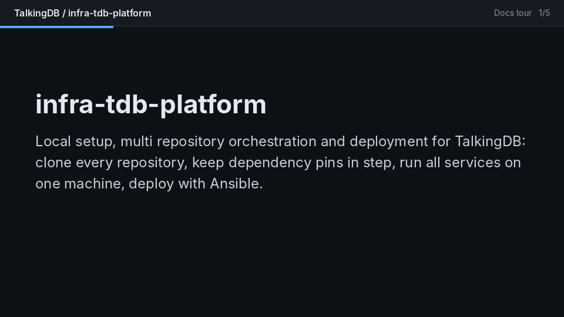

# infra-tdb-platform

Local setup, multi repository orchestration and deployment for the TalkingDB ecosystem: clone every repository, keep their dependency pins in step, run all services on one machine, and deploy with Ansible and GitHub Actions.


<p align="center">
  
</p>
<p align="center"><sub>A short tour: what it is, how to start, and what to read next.</sub></p>

| Start here | Go deeper |
| :--- | :--- |
| [What is in here](#what-is-in-here) | [Architecture: local runs, releases, deployment](docs/architecture.md) |
| [Where this fits](#where-this-fits) | [Usage and examples: every make target and tdbcli command](docs/usage-and-examples.md) |
| [Quickstart: a working local stack](#quickstart-a-working-local-stack) | [Troubleshooting](docs/troubleshooting.md) |
| [What this repo is not](#what-this-repo-is-not) | [Related repositories](#related-repositories) |

All pages: [docs/](docs/README.md).

## What is in here

| Folder | Purpose |
| :--- | :--- |
| [`Makefile`](Makefile) and [`scripts/`](scripts/) | Local workflow: clone, sync, run, stop, push, and the `tdbcli` command |
| [`local/repo.yaml`](local/repo.yaml) | The repositories `make clone` fetches |
| [`config/config.yaml`](config/config.yaml) | Minimum Python version, virtual environment name, Traefik settings |
| [`ansible/`](ansible/) | Server provisioning and deployment: [Docker](https://docs.docker.com/get-started/docker-overview/) host, secrets, runtime config, services, dataset sync, health check |
| [`docker/`](docker/) | Compose files for module-ttt and the Traefik reverse proxy |
| [`.github/workflows/`](.github/workflows/) and [`actions/`](actions/) | Reusable release pipeline: sync repositories, build images, deploy, notify |
| [`backstage/`](backstage/) | Service catalogue entries for [Backstage](https://backstage.io/docs/features/software-catalog/) |
| [`.devcontainer/`](.devcontainer/) and [`vscode/`](vscode/) | Dev container and VS Code debug configuration |

## Where this fits

<picture>
  <source media="(prefers-color-scheme: dark)" srcset="docs/images/where-infra-tdb-platform-fits-dark.svg">
  
</picture>

<sub>Diagram source: [where-infra-tdb-platform-fits.mmd](docs/diagrams/where-infra-tdb-platform-fits.mmd). Edit it and re-render with the steps in [docs/diagrams](docs/diagrams/README.md).</sub>

In words: this repository lives beside all the others, drives them as a group on your machine, and holds the pipeline and playbooks that ship them to a server.

## Quickstart: a working local stack

You need Bash (Linux, macOS or [WSL](https://learn.microsoft.com/en-us/windows/wsl/about)), Git, Python 3.12, [Poetry](https://python-poetry.org/docs/#installation) and [yq](https://github.com/mikefarah/yq).

```bash
mkdir talkingdb && cd talkingdb
git clone https://github.com/TalkingDB/infra-tdb-platform.git
cd infra-tdb-platform
make doctor        # checks yq, Python version and the shared virtual environment
make clone         # clones the repositories in local/repo.yaml next to this one
make sync mode=local
make local         # runs `make local` in every ../package-* and ../module-*
make logs          # follow all logs; Ctrl+C to stop following
make kill          # stop everything
```

Default ports once running: module-ttt 8090, content elementizer 8091, NEL 8092, parse-tree 8093, document search 8094, search trainer 8095, ecommerce AI 8096. module-ttt loads its secrets with [Infisical](https://infisical.com/docs/cli/overview) unless you set `SECRETS_MODE=dotenv` and provide a `.env` file.

> [!WARNING]
> `make push` runs `git add .`, commits and pushes in **every** repository in the workspace. Any unfinished work in any of them goes with it. Check `git status` everywhere first, or push repositories one by one.

## What this repo is not

- **Not an application.** It contains no TalkingDB features; it runs and ships the repositories that do.
- **Not the source of version pins.** Each repository's own `pyproject.toml` is; `make sync` rewrites them there.
- **Not complete for every repository yet.** `make clone` fetches six repositories (the base three, content elementizer, NEL and module-ttt); the newer `package-*` and `module-ecommerce-ai` repositories are cloned by hand.
- **Not Windows native.** Scripts are Bash; use WSL or the dev container.

## Related repositories

| Repository | Relationship |
| :--- | :--- |
| [base-tdb-helpers](https://github.com/TalkingDB/base-tdb-helpers#keep-git-pins-and-local-checkouts-in-step) | Owns `sync_git_deps.py`, which `make sync` runs in each repository |
| [module-ttt](https://github.com/TalkingDB/module-ttt) | The service the Ansible roles and Docker compose files deploy |
| [package-named-entity-linker](https://github.com/TalkingDB/package-named-entity-linker), [package-content-elementizer](https://github.com/TalkingDB/package-content-elementizer) | Cloned and run by `make clone` and `make local` |
| [flowbot-framework](https://github.com/TalkingDB/flowbot-framework) | Listed in the Backstage catalogue under the Flowbot system |

## Further reading

- [Ansible playbooks](https://docs.ansible.com/ansible/latest/playbook_guide/index.html)
- [GitHub Actions reusable workflows](https://docs.github.com/en/actions/concepts/workflows-and-actions/reusing-workflow-configurations)
- [Traefik documentation](https://doc.traefik.io/traefik/)
- [Development containers](https://containers.dev/)

## Code contributor

mayank.g@smarter.codes

## Support TalkingDB

If infra-tdb-platform saved you time, please [give it a star](https://github.com/TalkingDB/infra-tdb-platform) ⭐. Stars help other developers find the project.

Found a bug, or a document it gets wrong? [Open an issue](https://github.com/TalkingDB/infra-tdb-platform/issues/new). We are always here to help and open to a conversation. Explore the TalkingDB applications at [talkingdb.io](https://talkingdb.io/#applications).

## License

Licensed under the GNU Affero General Public License v3.0 ([AGPL-3.0](https://www.gnu.org/licenses/agpl-3.0.html)). See [LICENSE](LICENSE).
