# Architecture

[Docs home](README.md) › Architecture

How the local workflow, the release pipeline and the Ansible deployment fit together. For setup, start at the [README](../README.md).

## Local workflow

All scripts assume one workspace folder holding every repository side by side, with this repository among them.

<picture>
  <source media="(prefers-color-scheme: dark)" srcset="images/local-workflow-scripts-dark.svg">
  
</picture>

Diagram source: [local-workflow-scripts.mmd](diagrams/local-workflow-scripts.mmd). Edit it and re-render with the steps in [docs/diagrams](diagrams/README.md).

In words: clone fetches the repositories, sync pulls and re-pins them, local starts each service in the background, and push commits and pushes everything at once.

Order matters in `sync_git.sh`: `base-tdb-models` and `base-tdb-clients` first (pull only), then `base-tdb-helpers`, then every `package-*`, then every `module-*`, so each layer pins the layer below after it has been updated.

## The `tdbcli` command

[`scripts/tdbcli.sh`](../scripts/tdbcli.sh) wraps the same scripts so they can be run from anywhere once installed (`make tdbcli-install-user` puts it in `~/.local/bin`).

| Command | Runs |
| :--- | :--- |
| `tdbcli sync` | `scripts/sync_git.sh` |
| `tdbcli push` | `scripts/push_git.sh` |
| `tdbcli deploy` | `scripts/deploy.sh` (same modes as below) |
| `tdbcli add` | `scripts/add_dep.sh` |
| `tdbcli rlog` | `scripts/reset_logs.sh`, with `sudo` |
| `tdbcli cmd` | `scripts/cmd_helper.sh` |

It finds this repository by, in order: the `AW_REPO_ROOT` environment variable, `~/.tdbcli/config` (`REPO_ROOT=...`), or the `.tdbcli_root` marker file in the current folder or a parent. It writes the config file the first time it finds the root.

## `deploy.sh` modes

| Mode | Does | Needs in each repository's Makefile |
| :--- | :--- | :--- |
| `local` | Starts `make local` in every package and module, in the background | `local` |
| `logs` | Follows every package's log | nothing |
| `kill` | Stops the background processes started by `local` | nothing |
| `up`, `down`, `status` | Start, stop or list using a container style contract | `dev`, `down`, `log` (optional `sync`, `ps`) |

> [!NOTE]
> As of 25 November 2026 no package or module Makefile defines `dev`, `down` or `log`, so `up`, `down` and `status` report every repository as missing a target. Use `local`, `logs` and `kill`.

## Release pipeline

[`.github/workflows/release.yml`](../.github/workflows/release.yml) is started by hand (`workflow_dispatch`) and calls four reusable workflows in turn:

<picture>
  <source media="(prefers-color-scheme: dark)" srcset="images/release-pipeline-dark.svg">
  
</picture>

Diagram source: [release-pipeline.mmd](diagrams/release-pipeline.mmd). Edit it and re-render with the steps in [docs/diagrams](diagrams/README.md).

In words: a release syncs the repositories, builds their images, deploys them and reports the result.

## Ansible deployment

[`ansible/site.yml`](../ansible/site.yml) applies these roles to every host in the inventory, in order:

| Role | Purpose |
| :--- | :--- |
| `common` | Base packages and settings |
| `docker_host` | [Docker](https://docs.docker.com/get-started/docker-overview/) engine |
| `secrets` | Service secrets |
| `runtime_config` | `.env` and [Traefik](https://doc.traefik.io/traefik/) configuration from templates |
| `deploy_services` | Compose services, starting with `module-ttt` |
| `dataset_sync` | Datasets pulled with [DVC](https://dvc.org/doc) |
| `healthcheck` | Checks the services answer |

Environment values live in [`ansible/group_vars/`](../ansible/group_vars/) (`all`, `staging`, `prod`); the local inventory is in [`ansible/inventories/local/`](../ansible/inventories/local/).

## Service catalogue

[`backstage/`](../backstage/) describes ten components in two systems (TalkingDB and Flowbot) for a [Backstage](https://backstage.io/docs/features/software-catalog/) software catalogue. Keep it in step when repositories are added.

---

**Related:** [Troubleshooting](troubleshooting.md) · [Usage and examples](usage-and-examples.md) · [README](../README.md)
